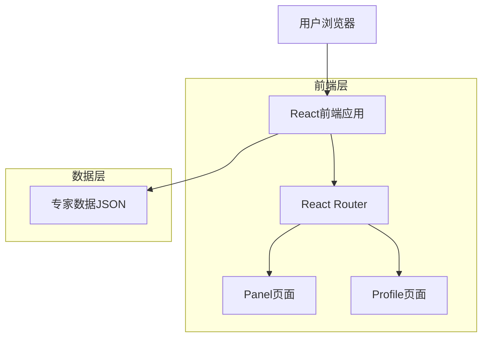
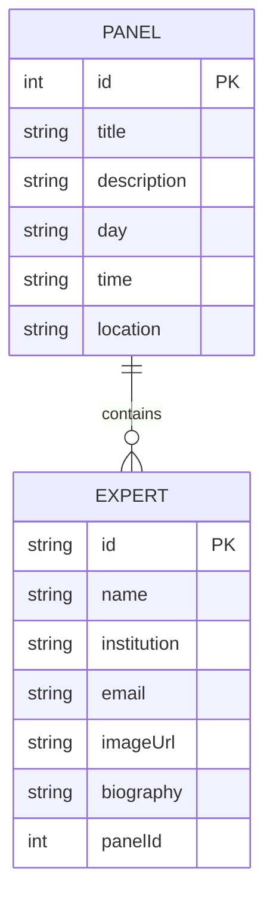
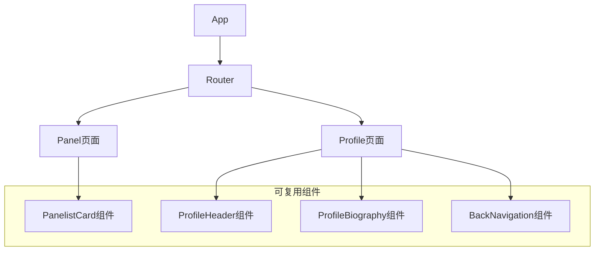

# 专家个人简历页面技术架构文档

## 1. 架构设计



## 2. 技术描述

* 前端：React\@18 + TypeScript + React Router\@6 + Tailwind CSS\@3 + Vite

* 后端：无需后端服务

* 数据存储：本地JSON数据文件

## 3. 路由定义

| 路由                 | 用途                            |
| ------------------ | ----------------------------- |
| /panel             | Panel页面，显示所有专家列表              |
| /profile/:expertId | 专家个人简历页面，通过expertId参数显示对应专家信息 |

## 4. 数据模型

### 4.1 数据模型定义



### 4.2 数据定义

**专家数据结构 (Expert Interface)**

```typescript
interface Expert {
  id: string;           // 唯一标识符，用于路由参数
  name: string;         // 专家姓名
  institution: string;  // 所属机构
  email: string;        // 联系邮箱
  imageUrl: string;     // 头像图片路径
  biography: string;    // 详细简历描述
  panelId: number;      // 所属Panel ID
}
```

**Panel数据结构 (Panel Interface)**

```typescript
interface Panel {
  id: number;
  title: string;
  description: string;
  day: string;
  time: string;
  location: string;
  panelists: Expert[];
}
```

**专家数据文件 (experts.json)**

```json
{
  "experts": [
    {
      "id": "maria-martinez",
      "name": "María de Lourdes Martínez",
      "institution": "Universidad Panamericana",
      "email": "lmartine@up.edu.mx",
      "imageUrl": "/Maria.png",
      "biography": "La Dra. Lourdes Martínez Villaseñor es Ingeniera en Sistemas Computacionales...",
      "panelId": 1
    },
    {
      "id": "juan-sossa",
      "name": "Juan Humberto Sossa Azuela",
      "institution": "CIC-IPN",
      "email": "hsossa@cic.ipn.mx",
      "imageUrl": "/Juan Humberto Sossa Azuela.jpg",
      "biography": "Juan Humberto Sossa Azuela es doctor en Informática...",
      "panelId": 1
    }
  ]
}
```

## 5. 组件架构

### 5.1 组件层次结构



### 5.2 核心组件功能

**Panel页面增强**

* 为每个专家卡片添加onClick事件处理

* 使用React Router的useNavigate进行页面跳转

* 添加鼠标悬停效果和点击反馈

**Profile页面**

* 通过useParams获取expertId路由参数

* 根据expertId查找对应专家数据

* 渲染专家详细信息和简历

* 提供返回Panel页面的导航

**数据管理**

* 创建专家数据的JSON文件

* 使用React hooks管理组件状态

* 实现数据的查找和过滤功能

## 6. 实现步骤

1. **创建专家数据文件**：整理所有专家信息到JSON格式
2. **创建Profile页面组件**：实现个人简历页面布局和功能
3. **修改Panel页面**：添加点击跳转功能
4. **配置路由**：在App.tsx中添加新的路由配置
5. **样式优化**：确保响应式设计和用户体验
6. **测试验证**：测试所有专家的跳转和显示功能

