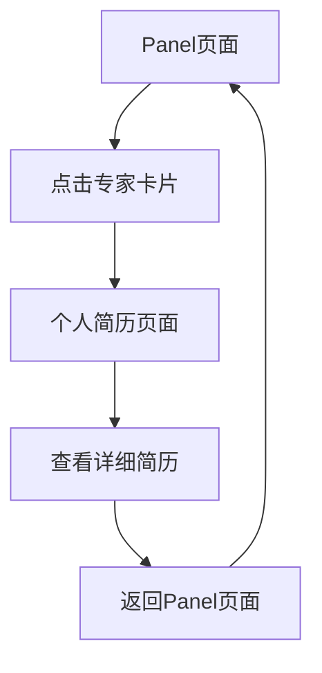

# 专家个人简历页面需求文档

## 1. 产品概述
为会议Panel中的专家创建个人简历页面，用户可以通过点击Panel页面中的专家信息跳转到相应的个人简历详情页面，提供更详细的专家背景信息和学术成就展示。

该功能旨在增强用户对专家的了解，提升会议的专业性和权威性，帮助参会者更好地了解Panel讨论的专家背景。

## 2. 核心功能

### 2.1 用户角色
本功能不需要区分用户角色，所有访问者都可以查看专家简历信息。

### 2.2 功能模块
我们的专家简历功能包含以下主要页面：
1. **个人简历页面**：专家头像、基本信息、详细简历描述、返回导航
2. **Panel页面增强**：专家卡片可点击跳转功能

### 2.3 页面详情

| 页面名称 | 模块名称 | 功能描述 |
|---------|---------|---------|
| 个人简历页面 | 专家头像区域 | 显示专家的高质量头像照片，支持默认头像生成 |
| 个人简历页面 | 基本信息区域 | 显示专家姓名、所属机构、联系邮箱等基本信息 |
| 个人简历页面 | 简历描述区域 | 展示专家的详细学术背景、研究领域、获奖情况、发表论文等信息 |
| 个人简历页面 | 导航区域 | 提供返回Panel页面的导航按钮和面包屑导航 |
| Panel页面 | 专家卡片增强 | 为每个专家卡片添加点击跳转功能，支持鼠标悬停效果 |

## 3. 核心流程
用户在Panel页面浏览专家信息时，可以点击任意专家卡片跳转到该专家的个人简历页面查看详细信息，然后通过导航按钮返回Panel页面继续浏览其他专家。

## 4. 用户界面设计

### 4.1 设计风格
- 主色调：蓝色系（#3b82f6）和紫色系（#8b5cf6）渐变
- 辅助色：灰色系（#f9fafb, #6b7280）
- 按钮样式：圆角按钮，支持悬停效果
- 字体：系统默认字体，标题使用较大字号（24px-32px），正文使用中等字号（14px-16px）
- 布局风格：卡片式设计，居中布局
- 图标风格：使用Lucide React图标库，简洁现代风格

### 4.2 页面设计概览

| 页面名称 | 模块名称 | UI元素 |
|---------|---------|--------|
| 个人简历页面 | 专家头像区域 | 大尺寸圆形头像（120px），居中显示，带阴影效果 |
| 个人简历页面 | 基本信息区域 | 专家姓名（大标题），机构名称（蓝色文字），邮箱（带邮件图标） |
| 个人简历页面 | 简历描述区域 | 白色卡片背景，段落式文本布局，行间距适中，支持长文本显示 |
| 个人简历页面 | 导航区域 | 返回按钮（带箭头图标），面包屑导航，固定在页面顶部 |
| Panel页面 | 专家卡片增强 | 添加鼠标指针样式，悬停时背景色变化，点击时有轻微缩放效果 |

### 4.3 响应式设计
- 桌面优先设计，支持移动端自适应
- 在移动设备上，专家卡片采用单列布局
- 个人简历页面在移动端优化文字大小和间距
- 支持触摸交互优化，按钮和链接区域足够大

## 5. 专家数据结构

### Panel 1. Education in the AI Era 专家信息：

**1) María de Lourdes Martínez**
- 机构：Universidad Panamericana
- 邮箱：lmartine@up.edu.mx
- 简历：La Dra. Lourdes Martínez Villaseñor es Ingeniera en Sistemas Computacionales por el Tecnológico de Monterrey Campus Estado de México, Maestra en Educación Familiar por el IPCE de la Universidad Panamericana y Doctora en Ciencias Computacionales del Tecnológico de Monterrey, Campus Estado de México. Es profesora investigadora nivel D en el área de inteligencia artificial en la Universidad Panamericana y jefa académica de la Maestría en Ciencia de Datos. Tiene la distinción de nivel 1 del Sistema Nacional de Investigadores del Conahcyt y de Profesor investigador nivel D de la Universidad Panamericana. Es Presidenta de la Sociedad Mexicana de Inteligencia Artificial. Ganó el premio de Mujer Líder en Inteligencia Artificial Responsable en Norteamérica 2023. Este año es ganadora también del Trailblazer Award – Woman in AI of the Year de Norteamérica 2025. Sus principales intereses de investigación son la inteligencia artificial aplicada al cuidado de la salud, el modelado de usuarios, y la ética de la inteligencia artificial. Ha sido docente por más de 32 años y autora de más de 65 publicaciones en revistas y conferencias internacionales, capítulos de libros y libros en el área de inteligencia artificial.

**2) Juan Humberto Sossa Azuela**
- 机构：CIC-IPN
- 邮箱：hsossa@cic.ipn.mx
- 简历：Juan Humberto Sossa Azuela es doctor en Informática por el Instituto Nacional Politécnico de Grenoble, Francia. Es profesor de tiempo completo del Instituto Politécnico Nacional y Director del Centro de Investigación en Computación. Es miembro Emérito del Sistema Nacional de Investigadores. Es miembro de la Academia Mexicana de Ciencias y miembro de la Academia de Ingeniería. Es también miembro Senior del Instituto de Ingenieros Eléctricos y Electrónicos (IEEE) y de la Sociedad Internacional de Redes Neuronales (INNS). Es miembro de la Academia de Maquinaria Computacional (ACM) y Fellow de la Sociedad Mexicana de Inteligencia Artificial (SMIA). En 2021 fue galardonado con el Premio Nacional de Computación por parte de la Academia Mexicana de la Computación (AMEXCOMP). En 2023 fue galardonado con el Premio a la Investigación en Instituto Politécnico Nacional en el area de investigación básica. En 2024 recibió por parte del Tecnológico de Estudios Superiores de Ecatepec un Doctorado Honoris Causa. Es autor de 5 libros de texto, 13 patentes, 32 derechos de autor y más de 500 trabajos de congreso y revista. Ha impartido más de 570 pláticas por invitación. Sus áreas de investigación son en Inteligencia Artificial, Aprendizaje para Máquinas, Redes Neuronales Artificiales, Análisis de Imágenes, Reconocimiento de Patrones, Robótica y Metaversos.

**3) Xiaoou Li**
- 机构：Cinvestav
- 邮箱：lixo@cs.cinvestav.mx
- 简历：Dr. Xiaoou Li is a Researcher and Professor in the Computer Science Department at CINVESTAV-IPN in Mexico. She has also been a Senior Research Fellow at Queen's University Belfast, the University of California Santa Cruz, Shenzhen University, and Northeastern University for her sabbatical leaves. Dr. Li is a member of the Mexican Academy of Science and a Level 3 member of the National Researcher System of Mexico (SNII). She is the author/co-author of over 300 publications in international journals, books, and conference proceedings. Her research interests include machine learning, data mining applications, data-driven sustainable and green automation, robot-assisted rehabilitation systems, and learning in technology-rich environments. Dr. Li actively organizes academic events and has served as the General Chair of IEEE conferences such as ICNSC 2016 and CASE 2022, and as the Program Chair of SSCI 2023. She has been a member of various editorial boards, including IEEE Press, Engineering Applications of Artificial Intelligence (EAAI), IEEE Transactions on Automation Science and Engineering (T-ASE), IEEE/CAA Journal of Automatica Sinica (JAS), IEEE Access, and IEEE SMC Magazine. She was a member of IEEE James H. Mulligan, Jr. Education Medal Committee (2019-2023).

**4) Genaro Juarez Martinez**
- 机构：ESCOM-IPN
- 邮箱：gjuarezm@ipn.mx
- 简历：Genaro J. Martínez is a full-time researcher at the National Polytechnic Institute in Mexico City. He is an active member of several institutions and laboratories around the world, such as the International Unconventional Computing Laboratory at the University of the West of England in the United Kingdom; the Foundation of Computer Science Laboratory at the Hiroshima University in Japan; the Center for Chaos and Complex Networks at the City University of Hong Kong in China; the Unconventional Algorithms and Computing Lab at the Technical University of Ostrava in Czech Republic; the Laboratoire de Recherche Scientifique in France, and the Institute des Systemes Complexes en Normandie in France. Prof. Martínez is an editorial member of the Journal of Cellular Automata, Complex Systems, Physica D, International Journal of Bifurcation and Chaos, and other scientific journals.

**5) Joselito Medina Marín**
- 机构：Universidad Autónoma del Estado de Hidalgo
- 邮箱：jmedina@uaeh.edu.mx

**6) Lisbeth Rodriguez Mazahua**
- 机构：Instituto Tecnológico de Orizaba
- 邮箱：lisbethr08@gmail.com

### Panel 2. Opportunities of AI Application in Mexico 专家信息：

**1) Giner Alor Hernández**
- 机构：Tecnológico Nacional de México
- 邮箱：galor@ito-depi.edu.mx

**2) Bella Martínez Seis**
- 机构：UPIITA-IPN
- 邮箱：bcmartinez@ipn.mx

**3) Jorge Alvarado Sánchez**
- 机构：Google
- 邮箱：TBD

**4) Dr. Mario César Maya Rodríguez**
- 机构：ESIME (Zacatenco)-IPN
- 邮箱：mmayar@ipn.mx

**5) Dr. Hipolito Aguilar Sierra**
- 机构：Universidad La Salle México
- 邮箱：hipolito.aguilar@lasalle.mx

**6) Andrés José Rodríguez Torres**
- 机构：Instituto Tecnológico Autónomo de México
- 邮箱：andres.rodriguez.torres@itam.mx